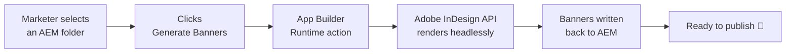
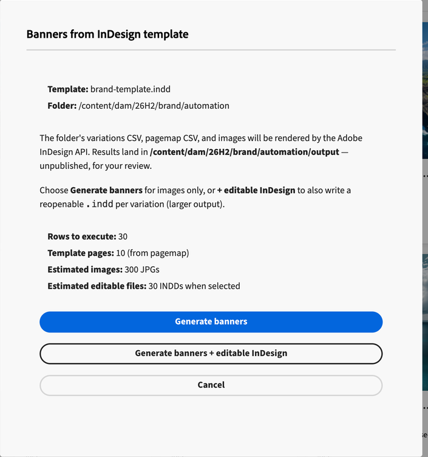

# 🎨 Banner Automation — on-brand banners (InDesign **and** Photoshop templates)

**One template. One CSV. Every size, every variation — rendered automatically, perfectly on-brand.**

Turn a single InDesign template and a row of content into a *complete* set of
production-ready banners — every ad size, every localized variant — without a
designer ever touching InDesign. It runs **headless in the cloud** on the Adobe
InDesign API: no desktop app, no manual export, no workstation in the loop — a
whole campaign's worth of on-brand banners, rendered on demand.

> **Works with InDesign (`.indd`) and Photoshop (`.psd`) templates.** Select either in
> AEM Assets View and click **Generate Banners** — InDesign templates render on the
> Adobe InDesign API, Photoshop templates on the Adobe Photoshop API (v2). See
> [Photoshop (PSD) templates](#photoshop-psd-templates).


<sub>Every banner above came from **one** InDesign template + a spreadsheet of variations — different placements, English/Spanish headlines, and multiple campaign versions. All output is brand-neutral sample content.</sub>

---

## The problem this kills

Every campaign needs the *same* creative in a dozen shapes: leaderboard,
skyscraper, square, story, half-page, mobile banner… now multiply that by each
market, each headline, each hero image, each city. That's **hundreds of
hand-crafted files** per launch.

Today that means a designer in InDesign, resizing frames, re-flowing copy,
swapping images, and re-exporting — for hours — while the brand team waits. It's
slow, it doesn't scale, and every manual step is a chance to drift off-brand.

## The fix

```
   your InDesign template          your content (CSV)
   (the brand, locked in)          headline, city, hero, filename
            │                              │
            └──────────────┬───────────────┘
                           ▼
                 ┌───────────────────┐
                 │   Banner Auto      │   drives InDesign programmatically
                 │  generate_*.jsx    │   — the brand template is the source of truth
                 └───────────────────┘
                           ▼
        every size × every variation, on-brand
        rendered as JPG + editable INDD — in seconds, unattended
```

- **The template holds the design.** Colors, type, spacing, logo lockups,
  grid — all governed by one InDesign file. Change the template, and *every*
  output updates. No copy-paste, no drift. The set of sizes is defined in the
  template, so any org can run **as many layout variations as it needs** —
  nothing here is fixed to a particular count.
- **The CSV holds the content.** One row per variation: headline, city, hero
  image, output name. Add a row → get a full size-set for it.
- **The script does the work.** It lays out every size for every row, places the
  right imagery, fits the copy, and exports — deterministically, every time.

## Why InDesign, and not Photoshop?

This same automation already exists in Photoshop, and Photoshop is superb at
image compositing. But a banner is, at its core, a **typographic layout
problem** — and that is exactly what InDesign is built to solve. Photoshop is a
raster image editor; InDesign is a professional page-layout and publishing
application. When copy has to fit, wrap, and stay on-brand across dozens of
sizes, that distinction is decisive.

**Superior text handling — the deciding factor**

- **A publication-grade text engine.** InDesign's paragraph composer, hyphenation
  and justification, optical kerning, baseline grids, and full OpenType control
  produce typesetting quality that Photoshop's type tool is not designed to match.
- **Overset detection.** An InDesign text frame *knows* when copy doesn't fit, so
  the automation can catch an over-long headline and flag it instead of silently
  shipping a broken layout. Photoshop has no equivalent notion of text that
  "doesn't fit."
- **Predictable copy-fitting.** Auto-sizing text frames and precise fitting rules
  mean headlines scale into their allotted space consistently across every size.

**A layout tool, purpose-built for this work**

- **Native multi-size documents.** However many banner sizes you need are simply
  that many pages — each with its own geometry — in a single document. That is
  InDesign's natural model; Photoshop leans on artboards, which are a weaker fit
  for distinct page sizes.
- **Centralized paragraph and character styles.** Brand typography is defined once
  and applied everywhere; change a style and every instance updates in lockstep.
- **Frame-based image fitting.** Placing artwork into defined frames (fill
  proportionally, auto-fit) is a first-class layout operation — precisely the
  banner use case.
- **Vector-first and resolution-independent.** Text and vector artwork stay crisp
  at any output size, rather than being baked into a fixed-resolution raster comp.

**Built for data-driven production**

- **Data Merge is a native InDesign capability.** "One template + one data source →
  many variations" is a canonical InDesign workflow, not a bolt-on.
- **Preflight for automated QA.** InDesign can validate a layout — missing fonts,
  overset text, low-resolution links — giving the pipeline built-in quality checks.
- **A truly editable deliverable.** The output `.indd` is a structured layout a
  designer can reopen and refine, not a flattened image — and its swapped images
  are live [AEM Asset Link](#editable-indds-keep-aem-asset-link-references)
  references back to the source assets in AEM.

> **In short:** Photoshop paints pixels; InDesign composes pages — and a banner is
> a page.

That said, plenty of design teams already live in Photoshop, so **Photoshop (`.psd`)
templates are supported too** — one artboard per size, layers named after the CSV
columns. Pick InDesign when copy-fitting and editable layouts matter most; pick
Photoshop when your templates are already built there. Details in
[Photoshop (PSD) templates](#photoshop-psd-templates).

## The vision: one click, right inside AEM

The endgame is a **"Generate Banners" button in Adobe Experience Manager Assets.**

> A marketer opens an AEM folder that holds a template, a variations CSV, and the
> campaign images. They click **Generate Banners**. Moments later the finished,
> on-brand banners appear back in that same folder — ready to publish.

No design bottleneck. No tool handoff. No ticket queue. **Content velocity at
scale, with the brand guaranteed by the template.** The folder *is* the job:
drop in the ingredients, click once, collect the results.



---

## Why the approach is nice

- **Cloud-rendered and deterministic.** `generate_variations.jsx` runs headless
  on the Adobe InDesign API and resolves its own working directory, so the same
  job produces the same banners every time — no workstation, no manual setup,
  nothing to babysit.
- **Folder-as-key convention.** A job is just a folder: the `*template*.indd` or
  `*template*.psd`, a variations CSV, a `*pagemap*` CSV, the images, and an `output/` folder. No
  config files, no database — the layout *is* the contract.
- **Cloud-native & serverless.** No InDesign or Photoshop desktop to install or babysit.
  Rendering happens on Adobe's infrastructure and scales with the work.
- **Governed by design, not by discipline.** On-brand output isn't a review
  step you hope people follow — it's a property of the template they can't
  bypass.
- **Zero dependencies.** The cloud harness is a single Node ≥ 18 file: no npm
  install, no supply chain, easy to audit and drop anywhere.

---

## How it works

| Layer | What it does |
|------|--------------|
| **`scripts/generate_variations.jsx`** | The engine. Reads the CSV, lays out every configured size per row, places hero/lockup art, fits copy, exports JPG + INDD. |
| **`scripts/brand_lib.jsx`** | Shared library: size definitions, fonts, defaults, and the working-dir resolver the cloud job relies on. |
| **`scripts/build_template.jsx`** | Generates the master template from spec, so the design itself is reproducible. |
| **`cloud/run.mjs`** | The harness. Authenticates to Adobe IMS, registers the script as an InDesign *capability*, uploads inputs, runs the job, polls, and retrieves outputs. |
| **AEM Assets View extension** | The one-click UI: an Action Bar button that hands the selected folder to an App Builder Runtime action, which calls the InDesign API and writes results back to AEM. |

### Pipeline phases

```
Phase 1  Rendering engine       ✅  proven — one template + CSVs → the full size-set
Phase 2  Cloud rendering        ✅  headless render on the Adobe InDesign API
Phase 3  AEM one-click          ✅  "Generate Banners" in Assets View → render → write back
```

---

## See it in action


*One template, rendered across every placement — leaderboard, billboard, half-page,
med-rectangle, app card, social feed, story — in English and Spanish, in multiple
campaign versions. Change the template once and all of these regenerate.*

👉 **Want to build your own?** The [**examples/**](examples/README.md) folder is a
complete, brand-neutral walkthrough: author your template, write the variations
CSV and pagemap CSV, render, and collect the output — with the sample files used
above.

## Quick start

Drive the Adobe InDesign API from the cloud harness (Node ≥ 18, zero deps):

```bash
node cloud/run.mjs --dry-run      # assemble & print the exact plan — no credentials needed
node cloud/run.mjs --check-auth   # fetch an IMS token and report
node cloud/run.mjs --ping         # reachability probe against the InDesign API
node cloud/run.mjs --register     # register the script as an InDesign capability
node cloud/run.mjs --submit       # full run: auth → upload → execute → poll → download
```

Start with `--dry-run`: it writes `cloud/_dryrun/{inputs,outputs,job-payload}.json`
so you can see *exactly* what would be sent before a single credential is used.
See [`cloud/README.md`](cloud/README.md) for setup and the storage seam.

## The folder contract

A campaign folder contains everything a job needs — nothing more:

```
your-campaign/
├── brand-template.indd        # the design (filename contains "template") — or brand-template.psd
├── variations.csv             # one row per banner variation
├── pagemap.csv                # size/page mapping (filename contains "pagemap")
├── hero-1.jpg, hero-2.jpg …   # imagery referenced by the CSV
└── output/                    # rendered JPG + INDD/PSD land here
```

Drop in the ingredients, run one command (or click one button in AEM) — collect
the results.

**Images can live in subfolders.** Keep the job folder tidy by sorting images into folders
(`hero-images/`, `components/logos/`, …) and refer to them from the CSV by path, where a leading
`/` means the job folder itself:

```csv
outputFileName,headline,hero,logo
spring-en,Spring is here,/hero-images/meadow.jpg,components/logos/brand.png
```

A bare name (`meadow.jpg`) still works: it is looked up in the job folder, then by name in its
subfolders (if two different files share that name, the job stops and asks for a path). References
cannot leave the job folder, and `output/` and `fonts/` are never searched. This works for both
InDesign and Photoshop templates; the render sees each image under a flat name, so two files called
`logo.png` in different folders are both fine.

**Several templates in one folder is fine.** In AEM, the template you *select* is the
one that runs, whether it is an `.indd` or a `.psd`; each template gets its own job, and
the button appears only when exactly one template is selected. (From the command line,
the first file named `*template*.indd|psd` is used.)

### Where results land

Results go to `<folder>/output`. If that folder already has assets, the run goes into a
datetime-stamped subfolder instead (`output/2026-10-22_171540`, UTC), so earlier results
are never mixed with or overwritten by a new run. The modal links straight to the output
folder in Assets View once the job starts (set `ASSETS_VIEW_TENANT`, see
[SETUP.md](SETUP.md)), and celebrates when the job completes. 🎉

### Editable INDDs keep AEM Asset Link references

When you choose **+ editable InDesign**, each generated `.indd` links its swapped
images back to the source assets in AEM — the same **Adobe Asset Link** placed
links a designer gets by placing from AEM — not to temporary files from the render.

How it works:

1. **Swapped images come from AEM.** An image the CSV names is taken from the job
   folder, or — if it isn't there — from the template's own AEM Asset Link
   references (matched by filename, same AEM author host only).
2. **Render.** The InDesign API downloads those images as local copies, so the
   render itself works.
3. **Remap.** After the render, each saved `.indd` is passed to the InDesign
   **Remap Links** API, which rewrites the local links to
   `aems://<author-host>/content/dam/...`, the form Asset Link writes. The remapped
   INDD is what lands in `output/`.

Opening the file:

- The links resolve in InDesign when the **Adobe Asset Link** panel is signed in to
  the same AEM environment. Without it, InDesign reports them as missing links.
- Only the images the CSV swaps are remapped. Other links keep whatever the template
  had (for example a local logo path, which resolves only on the machine that has it).
- Missing links are relinked at open by filename, if that file is in the job folder,
  so cloud renders still show static art such as a lockup.
- If a remap fails, the job still succeeds and that `.indd` keeps local links; the
  reason is logged and returned as `remapWarnings`.
- JPG outputs are unaffected.

### Photoshop (PSD) templates

A Photoshop template works like an InDesign one, with **layer names in place of Script
Labels**:

- **One artboard per size.** Name each artboard exactly like the `pagename` column of the
  pagemap CSV (`WEB_LEADERBOARD_1000x320`, …). Only the artboards the pagemap lists are rendered.
- **Layer name = CSV column.** A **text layer** named `headline` takes the `headline`
  column; a **smart object** named `hero` takes the image file named in the `hero` column.
  Use the same layer names on every artboard. Static layers (backgrounds, shapes, bars)
  are left alone, and hidden layers stay hidden. A line break in a cell becomes a paragraph
  break in the text layer.
- **Output.** One JPG per artboard per row (`<artboard>_<outputFileName>.jpg`). With
  **+ editable file**, one `.psd` per row too (all artboards), embedded smart objects.
- **Fonts.** Put the fonts the template uses in the shared `/content/dam/fonts` folder or the
  job's `fonts/` subfolder. A missing font fails the job rather than silently substituting one.
- **Hero photos.** A full-bleed smart object (its frame spans the artboard width) is
  cover-fitted like an InDesign photo frame: scaled to cover a wide frame anchored at the left,
  so the left of the photo stays prominent, then cropped by the artboard. The frame's shape is
  `PSD_HERO_FRAME_ASPECT` (width/height of the photo frame in your matching InDesign template;
  default `2.4709`; `0` = cover only the visible area). If the hero has a content band below it
  (a layer named `band`), the photo stops where the band starts. The hero's layer mask, if it has
  one, stays where the template put it, so use a mask to mark the visible area.
- **Needs** the Photoshop API (v2, Firefly Services) on the same Developer Console
  credential as the InDesign API — see [SETUP.md](SETUP.md).

Limits to know about: PSD text is replaced as-is (no copy-fit or overset detection), and a
shape behind a text layer (such as a highlight bar) does not resize to fit new copy — size
it for your longest value. The editable PSD embeds its images, so it carries no in-file AEM
links; the AEM relations below record the connection instead. Design notes, API settings
and what was learned getting the framing to match InDesign are in
[docs/PSD-DESIGN.md](docs/PSD-DESIGN.md).

### Relations in AEM

Assets View shows only explicit asset **relations**, not the automatic Asset Link
references, so after the INDDs are uploaded the job creates them through the AEM
Assets Author API (`/adobe/assets/{id}/relations`):

- **Template → INDD (or PSD):** each generated editable file is a *derived* asset of the job's
  template, so its Asset Relations panel shows the template as its source.
- **INDD/PSD ↔ images:** each INDD and the source images it links (the swapped images and
  other staged art such as the lockup) are related as *Other*, in both directions.

Existing relations are skipped, so reruns that overwrite the same output names are
safe. If the relation calls fail (for example the AEM credential isn't allowed to use
the Assets Author API), the job still succeeds and the reason is returned as
`relationWarnings`; the response also reports `relationsCreated`.

---

## Set up your own environment

Standing this up in your own org — InDesign API entitlement → OAuth credential →
presigned storage → AEM → the Assets View extension — is documented step by step in
**[SETUP.md](SETUP.md)**, with a filled-in `.env` template and a troubleshooting
table for the common gotchas.

## Long-render orchestration

The AEM extension starts a durable job in App Builder State and processes the variations CSV in small worker batches. Each worker invocation stays below the 600-second Runtime activation cap and queues the next batch, so closing the modal or browser does not cancel a render. A deterministic job key prevents duplicate starts, a state lock prevents concurrent workers, and completed output names are skipped on retries. See [`aem-extension/README.md`](aem-extension/README.md) for deployment and status-action details.

## AEM Assets View preview

The modal preflight shows the selected template, job folder, CSV row count,
template page count, and estimated output totals before starting a render:



## Status & roadmap

The full pipeline works end to end. The rendering engine, the cloud harness (IMS
auth, capability registration, job orchestration), a headless render on the live
InDesign API, and the one-click AEM experience are all in place: a **"Generate
Banners"** action in AEM Assets View hands the selected folder to an App Builder
Runtime action, which renders on the InDesign API and writes the results back into
the folder's `output/`.

- [x] Reproducible template generation
- [x] Full size-set rendering (one template → every placement)
- [x] Cloud harness: IMS auth, capability registration, job orchestration
- [x] Headless cloud render on the Adobe InDesign API
- [x] App Builder Runtime action + presigned storage + AEM read/write-back
- [x] AEM Assets View "Generate Banners" extension
- [x] Photoshop (`.psd`) templates via the Adobe Photoshop API — layer-name contract, editable PSDs, AEM relations
- [x] Timestamped output subfolders, output-folder link, selected-template handling

## Built with

Adobe InDesign · Adobe InDesign API and Adobe Photoshop API (Firefly Services) · ExtendScript · Adobe IMS
· Node.js · Adobe Experience Manager · App Builder / Adobe I/O Runtime

---

*Brand- and size-agnostic by design — bring your own template, fonts, content,
and as many layout variations as you need.*
